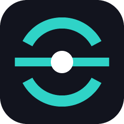

<p align="center"></p>

# Interceptium

Interceptium swaps Roblox game assets (textures, sounds, meshes, and so on) on **your own computer**.
It runs a small local proxy between the Roblox Player and Roblox's asset servers. When the game asks
for an asset, Interceptium can:

- **Replace** it with a different Roblox asset ID.
- **Remove** it, so it doesn't load.
- **Serve a local file** from your disk in its place.

Interceptium is an independent, clean-room project. It is written from scratch and shares no code with
other tools.

## Safety

Interceptium was designed to do one job and nothing else:

| | |
|---|---|
| **Local only** | The proxy listens on `127.0.0.1`. Other devices on your network can't reach it. |
| **No accounts, cookies or tokens** | It never reads your Roblox login, browser cookies or any credentials. |
| **No other servers** | No telemetry, no update checks, no downloads. The only traffic is Roblox's own traffic. |
| **Decrypts only Roblox asset hosts** | Only `assetdelivery.roblox.com`, `fts.rbxcdn.com` and `contentdelivery.roblox.com` are inspected. Every other connection is passed through as an encrypted tunnel it can't read. |
| **Name-constrained certificate** | The local certificate authority is created on your PC and carries an X.509 *Name Constraints* extension. It only works for `roblox.com` and `rbxcdn.com`. Even if someone stole it, it couldn't fake your bank, email or any other site. A test in `tests/` proves this. |
| **Not in your system trust store** | The certificate is only added to Roblox's own `ssl/cacert.pem`, never to Windows/macOS trust. |
| **No admin rights** | It doesn't edit the hosts file, system proxy settings or anything outside your user account. |
| **Verified upstream TLS** | Connections from Interceptium to Roblox are fully certificate-checked. |
| **Minimal dependencies** | Python standard library plus one package: [`cryptography`](https://cryptography.io) (PyCA), pinned in `requirements.txt`. |
| **Undoable** | **Remove from Roblox** (or `--uninstall`) takes the certificate and setting back out. |

## Download

Get the latest build from the [Releases](../../releases) page:

- **Windows:** `Interceptium-windows-x64.exe`
- **macOS:** `Interceptium-macos.zip`. The app isn't code-signed, so right-click it and choose **Open** the first time.
- **Linux:** `Interceptium-linux-x64`. On Linux it runs the proxy only and doesn't set up Roblox automatically.

`SHA256SUMS.txt` lists the checksum of each file. The builds are made by GitHub Actions from this
repository's source (see `.github/workflows/release.yml`).

## How to use

1. Open Interceptium.
2. In **Configs** (left), pick a config or press **+** to make one. Every config with its switch **on** runs, so you can mix packs.
3. Press **+ Add rule**:
   - **Assets to change:** asset IDs or asset types, for example `1234567 2345678` or `Image`.
   - **Action:** *Replace* (with another asset ID), *Remove*, or *Local file*.
4. Press the big round **power button** to start the proxy.
5. Press **Launch Roblox**, or join a game from the website. With *Reroute website launches* on (in Settings), Interceptium restarts that Roblox window through the proxy.
6. Roblox caches assets, so **clear the Roblox cache** after changing rules. *Clear cache when launching* does this for you.

## Configs and Fleasion compatibility

Interceptium uses the same JSON format as Fleasion, so you can import Fleasion configs directly with the **↓** button, or by
dropping them into the configs folder (the **⋯** button opens it).

```json
{"replacement_rules": [
  {"name": "Purple sky", "enabled": true, "replace_ids": ["6444884337", "6444884785"], "mode": "id", "with_id": 1012890},
  {"name": "No textures", "replace_ids": ["Image"], "mode": "remove"},
  {"type": "group", "name": "Sounds", "children": [
    {"name": "Gunshot", "replace_ids": ["130113322"], "mode": "local", "local_path": "/Sounds/shot.ogg"}
  ]}
]}
```

| Field | Meaning |
|---|---|
| `replace_ids` | Asset IDs, or asset type names (`Image`, `Audio`, `Mesh`, `Animation`, …) |
| `mode` | `id` replace with `with_id` · `remove` · `local` serve `local_path` |
| `local_path` | A normal path, or `/Folder/file` relative to the configs folder (portable packs) |
| groups | `{"type": "group", "children": [...]}` show as sections |

Which configs run is stored as `enabled_configs` in `settings.json`. Unknown keys in config files are kept when Interceptium saves.

**Not supported on purpose:** `cdn` rules (`cdn_url`) would make Roblox download from third-party servers. They show up as
*CDN URL (disabled)* and are skipped. TexturePack slot keys (`123:1`) are ignored.

### What happens to Roblox when you start the proxy

For each Roblox Player install it finds, Interceptium:

- adds its certificate in a marked block to `<install>/ssl/cacert.pem`;
- sets `DFFlagHttpUseEmbeddedCaCerts` to `False` in `<install>/ClientSettings/ClientAppSettings.json`, so Roblox uses that file;
- starts Roblox with `HTTPS_PROXY=http://127.0.0.1:58443`.

**Remove from Roblox** removes the first two changes again.

## Command line

```
Interceptium --headless           run the proxy without a window
Interceptium --headless --launch  ...and launch Roblox through it
Interceptium --port 60000         use a different port
Interceptium --clear-cache        delete Roblox's asset cache and exit
Interceptium --uninstall          remove Interceptium's certificate from Roblox and exit
```

Settings (`settings.json`) and configs (`configs/*.json`) are stored in `%LOCALAPPDATA%\Interceptium` (Windows),
`~/Library/Application Support/Interceptium` (macOS) or `~/.local/share/interceptium` (Linux).

## Run from source / build

Requires Python 3.11 or newer (3.14+ also handles zstd-compressed requests).

```
pip install -r requirements.txt
python run_interceptium.py

# tests
python -m unittest discover -s tests -v

# single-file executable
pip install -r requirements-build.txt
python tools/build.py
```

## Changing the logo

Replace `assets/logo.png` with a 256×256 PNG, then run `python tools/make_icon.py --from-png assets/logo.png`
to regenerate `assets/logo.ico`.

## Notes

- Roblox can change how its client works at any time, and that could stop asset swapping from working.
- Using modified clients may be against Roblox's Terms of Use. Use it at your own risk.
- Not affiliated with Roblox Corporation.

## License

MIT. See [LICENSE](LICENSE).
